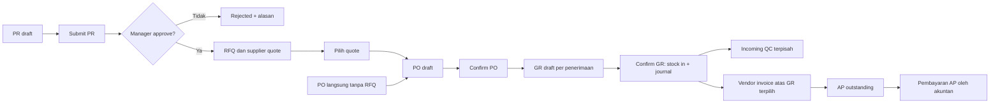
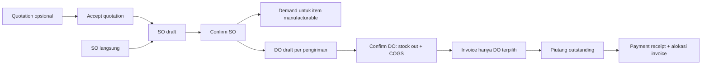
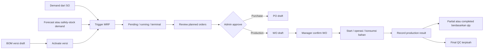

# UX Specification — ERP Manufaktur v1

Status: spesifikasi UX tahap pertama, berdasarkan inspeksi statis workspace pada 29 Oktober 2026.

Dokumen pasangan: [Screen inventory](screen-inventory.md) dan [Design system](frontend-design-system.md).
Belum ada UI, prototype FigCraft, atau perubahan business rules yang dibuat dalam tahap ini.

## 1. Tujuan, batasan, dan sumber kebenaran

Tujuan UX: pengguna dapat mengerjakan transaksi manufaktur dari permintaan sampai
pengadaan/produksi, pengiriman, invoice, pembayaran, dan pelaporan tanpa kehilangan
konteks tenant, status dokumen, outstanding quantity, atau dampak finansial.

Urutan sumber kebenaran:

1. Permission pada controller dan guard untuk akses endpoint.
2. DTO untuk input; service untuk validasi, perubahan status, dan side effect.
3. Migration untuk struktur dan constraint; bukan bukti bahwa setiap status/fitur mempunyai API.
4. Dokumentasi lama sebagai konteks, bukan pengganti kode.

Sumber yang diperiksa:

- [Role dan permission templates](../src/modules/auth/auth.constants.ts), [guard](../src/modules/auth/guards/auth.guard.ts), [auth service](../src/modules/auth/auth.service.ts), [seed administrator](../src/database/migrations/public/006_seed_admin.sql).
- Controller/DTO/service dalam `src/modules/{product,inventory,purchase-order,sales-order,bom,production,quality-control,accounting}`.
- [Error contract](../src/common/filters/global-exception.filter.ts), migration tenant 001–016, terutama [transactional integrity](../src/database/migrations/tenant/014_transactional_integrity.sql).

Inventaris statis mencakup **204 endpoint** pada sembilan controller modul: auth 6,
product 26, inventory 26, purchase-order 27, sales-order 25, BOM 17, production 23,
quality-control 15, accounting 39. Prefix API adalah `/api/v1`.

Klasifikasi bukti:

- **Fakta kode:** teramati langsung pada source; belum tentu direproduksi secara runtime dalam tugas ini.
- **Keputusan UX:** rancangan interaksi frontend yang tidak menambah aturan bisnis.
- **ASUMSI ASxx:** keputusan atau kebutuhan yang belum dikonfirmasi stakeholder/runtime.
- **BLOCKER BLxx / RISIKO Rxx:** gap yang harus diputuskan atau diverifikasi sebelum flow terkait dapat dinyatakan siap.

## 2. User role dan permissions

### 2.1 Model akses aktual

- Terdapat **7 template role** di `DEFAULT_ROLE_PERMISSIONS`.
- Seed membuat role bernama **Super Administrator** untuk tenant `admin`; namanya berbeda dari key template `admin`.
- Template bukan bukti bahwa role tersebut sudah diprovision untuk semua tenant. Daftar role/user aktual database tidak dibaca dalam tugas ini.
- Runtime menggabungkan permission seluruh role pengguna dengan **union**, bukan memilih satu role dominan.
- Frontend mengambil capability aktual dari `GET /auth/me`; nama role hanya label. Jangan hardcode akses berdasarkan string `manager` atau `admin`.
- Administrator tetap berada dalam tenant pada token. Tidak ada bukti akses lintas tenant atau global impersonation.
- Permission `write` mencakup create/update hanya bila endpoint tersedia. `approve` mencakup banyak confirm/post/cancel. `export` pada template tidak membuktikan adanya endpoint ekspor.
- Semua controller bisnis memasang JWT dan PermissionGuard; frontend menyembunyikan aksi tanpa akses, sedangkan backend tetap mengotorisasi request.

Legenda matriks: **R** read, **W** write, **D** delete, **A** approve, **X** export; `—` tidak diberikan template.

| Module | admin | manager | staff_gudang | staff_produksi | staff_pembelian | staff_penjualan | akuntan |
|---|---|---|---|---|---|---|---|
| `inventory` | RWDAX | RWAX | RW | R | — | R | — |
| `purchase_request` | RWDAX | RWA | — | — | RW | — | — |
| `purchase_order` | RWDAX | RWA | — | — | RW | — | — |
| `goods_receipt` | RWDAX | RWA | RW | — | R | — | — |
| `vendor_invoice` | RWDAX | RWA | — | — | RW | — | R |
| `sales_quotation` | RWDAX | RWA | — | — | — | RW | — |
| `sales_order` | RWDAX | RWA | — | — | — | RW | — |
| `delivery_order` | RWDAX | RWA | RW | — | — | R | — |
| `customer_invoice` | RWDAX | RW | — | — | — | RW | R |
| `bom` | RWDAX | RWA | — | R | — | — | — |
| `production` | RWDAX | RWA | — | RW | — | — | — |
| `mrp` | RWDAX | RW | — | — | — | — | — |
| `quality_control` | RWDAX | RWA | RW | RW | — | — | — |
| `accounting` | RWDAX | R | — | — | — | — | RWA |
| `bank` | RWDAX | — | — | — | — | — | RW |
| `reporting` | RWDAX | RX | — | — | R | R | RX |
| `user_management` | RWDAX | — | — | — | — | — | — |
| `role_management` | RWDAX | — | — | — | — | — | — |
| `master_data` | RWDAX | RW | R | R | R | R | — |
| `tenant_settings` | RWDAX | — | — | — | — | — | — |

### 2.2 Personas dan batas tanggung jawab

| Role/template | Tujuan pengguna | Tanggung jawab yang didukung | Batas/handoff |
|---|---|---|---|
| admin / Super Administrator | Menyiapkan operasi tenant dan menyelesaikan eskalasi | Seluruh endpoint bisnis dengan semua permission; master, approval MRP, posting, banking | User/role/tenant management API belum ada; bukan admin lintas tenant |
| manager | Mengendalikan keputusan dan exception operasional | Approval PR, RFQ quote, PO, GR, quotation, SO, DO, BOM, WO, QC; membaca accounting | Tidak mempunyai `mrp.approve`, `bank.*`, atau `accounting.write`; tidak otomatis boleh semua aksi |
| staff_gudang | Mencatat penerimaan, pengiriman, dan stok fisik | Draft GR/DO, movement, opname, batch; draft QC | Confirm/complete memerlukan approver; tidak mempunyai PO/SO read untuk lookup sumber |
| staff_produksi | Menjalankan pekerjaan produksi | Membaca BOM/stok, draft/start WO, konsumsi, operasi, hasil produksi, draft QC | Confirm/cancel WO dan complete QC ke manager/admin; tidak mempunyai MRP permission |
| staff_pembelian | Menyediakan bahan tepat waktu | PR, RFQ, quote supplier, draft/edit PO, vendor invoice; melihat GR | Approval ke manager/admin; lookup gudang memerlukan akses inventory yang tidak diberikan template |
| staff_penjualan | Memenuhi permintaan customer sampai penagihan | Quotation, SO, customer invoice, payment receipt; melihat DO/stok | Accept quotation/confirm SO ke manager; pengiriman ke gudang; tidak mempunyai accounting read |
| akuntan | Membayar kewajiban dan menjaga pencatatan keuangan | Tahun/periode, CoA, jurnal/post/reverse, GL, AP/AR, pembayaran AP, bank dan laporan | Payment receipt customer memakai `customer_invoice.write` yang tidak dimiliki; complete rekonsiliasi memakai `bank.approve` yang tidak dimiliki |

**ASUMSI AS01:** satu pengguna bisa memegang lebih dari satu template role. Inspector QC,
planner MRP, owner/direktur, cashier, dan superadmin platform belum merupakan template
tersendiri; jangan menambahnya sebagai role aktif. Bila diperlukan, provisioning
permission harus diputuskan terpisah dan tidak diubah dalam spesifikasi ini.

## 3. Modul, fitur, dan alur bisnis

### 3.1 Capability map

| Domain | Fitur tersedia pada API | Batas utama |
|---|---|---|
| Auth | Login tenant/email/password, me, refresh, logout, logout-all, change password | Tidak ada register, forgot password, invite, tenant switch API |
| Master produk | Produk, varian, atribut/nilai, kategori, UoM, konversi, batch | Supplier/customer belum mempunyai controller; batch memakai inventory permission |
| Inventory | Cabang, gudang, lokasi, stock on hand, per varian/lokasi, history, reorder alerts, movement, opname | Sebagian list bukan paginated; movement type tidak mempunyai endpoint lookup |
| Procurement | PR submit/approve/reject, RFQ/send/quote/select, PO draft/edit/confirm/cancel, GR draft/confirm, vendor invoice/overdue/cancel | PR/GR/RFQ tidak otomatis mempunyai draft update; send tidak membuktikan pengiriman email |
| Sales | Quotation create/edit/send/accept/reject/cancel; SO create/confirm/cancel; DO create/confirm/cancel; invoice parsial; receipt allocations | Tidak ada SO/DO update atau customer invoice cancel endpoint |
| BOM | Header, versi, material bertingkat, operasi, by-product, activate, explode | Versi active tidak bisa diedit; penghapusan komponen memerlukan `bom.delete` |
| Planning | Demands, trigger/status/cancel MRP, planned orders approve/cancel/bulk approve | Tidak ada manual retry, edit supplier/gudang planned order, progress persentase atau SSE API |
| Production | WO draft/edit/confirm/start/cancel, consume materials, hasil produksi, operation start/complete | Completion berdasarkan kuantitas hasil; tidak ada tombol complete WO tersendiri |
| QC | Parameter, checklist, defect type, incoming/final inspection, complete/cancel, defect summary | Hasil detail dikirim saat complete; tidak ada update hasil draft atau enforcement quarantine |
| Finance | Fiscal year/period, CoA, jurnal, post/reverse, GL, balances, AP/AR aging, AP payment, bank/reconciliation, tax code, overhead, empat laporan | Full costing, granular bank matching dan tax overhaul di luar kemampuan saat ini |
| Administration | Permission key user/role/tenant tersedia | Screen pengelolaannya belum didukung endpoint |

### 3.2 Flow purchase-to-pay

- RFQ dan PR adalah jalur pengadaan lengkap; `CreatePurchaseOrderDto` juga mendukung PO langsung tanpa RFQ. Jangan menjadikan PR/RFQ wajib di frontend.
- Create GR memakai PO confirmed/partial; confirm GR memvalidasi sisa kuantitas dan membuat movement/jurnal.
- Incoming QC membutuhkan GR confirmed. Barang sudah masuk stok sebelum QC; tidak ada rule blok stok sampai QC passed pada service yang diperiksa.
- Vendor invoice memakai GR confirmed dari PO yang sama dan belum terhubung invoice aktif lain. Total backend saat ini memakai kuantitas GR × harga PO dan pajak hardcoded 11%; ini fakta implementasi, **bukan rekomendasi pajak**.
- AP payment membuat allocation dan pencatatan akuntansi; paid/outstanding berasal dari backend.
- Linking PR → RFQ → PO adalah referensi dokumen. Jangan menjanjikan semua status PR otomatis ditutup tanpa memverifikasi jalur aktual (R09).

### 3.3 Flow order-to-cash

- SO dari quotation mensyaratkan quotation accepted dan customer cocok; SO langsung juga didukung.
- Confirm SO membuat demand untuk item yang produknya `can_be_manufactured`; jangan membuat duplikat demand manual untuk SO item yang sama.
- DO dibatasi pending quantity dan availability saat create; confirm memeriksa stok aktual. Comment service yang menyebut warning stok tidak sesuai dengan implementasi yang melempar 400; UX mengikuti error aktual.
- Invoice mengambil kuantitas DO, discount/tax dari SO, bukan seluruh total SO. DO yang sudah ditagih tidak boleh dipilih lagi.
- `SO.invoiced` berarti delivered quantity telah terinvoice menurut service; jangan menafsirkannya sebagai seluruh ordered quantity sudah terkirim atau pembayaran lunas.
- Receipt creation adalah aksi finansial langsung, bukan draft yang perlu post kedua kali; tidak ada endpoint delete/reverse receipt.

### 3.4 Flow plan-to-produce

- Planned purchase approval membutuhkan suggested supplier; API tidak menyediakan editor untuk mengisinya jika kosong.
- Approval memakai gudang aktif pertama yang ditemukan; WO otomatis menggunakan MTS. Tidak ada pemilih gudang/tipe produksi pada endpoint approve. Preview tidak boleh mengklaim gudang spesifik bila backend belum mengembalikannya.
- PO otomatis memakai cost price, dengan fallback `1` bila nol. Dokumen draft hasil approval wajib direview sebelum confirm.
- Bulk approve mengembalikan hasil per item dan dapat **sebagian sukses**; satu toast sukses global tidak cukup.
- WO confirm membuat material/operation requirements. Start, consume, result, dan operation actions mengikuti state yang diizinkan service.
- Record result menambah stock in, memperbarui quantity produced, dan menyelesaikan WO saat target tercapai; jurnal produksi dapat ikut dibuat.
- Risiko constraint movement pada WO ditandai **BL05**. Jangan menyatakan flow konsumsi → hasil → partial berulang siap sebelum reproduksi runtime.
- Final QC membutuhkan production result yang ada; tidak ada service yang menjadikan final QC gate otomatis completion WO atau ketersediaan stok.

### 3.5 Flow accounting dan penutupan

`Tahun fiskal open → periode open → jurnal draft → review debit/credit → post → GL/balance → laporan → close/lock periode`.

- Posting/reversal memakai `accounting.approve`; reversal memilih periode target dan membuat pencatatan balik, bukan menghapus histori.
- Periode `open → closed/locked`, `closed → locked`; locked tidak bisa diubah dan tidak ada reopen.
- Draft journal dapat memblokir closing; tampilkan tautan daftar draft bila permission memungkinkan.
- AP/AR list dan aging memakai `accounting.read`; financial reports memakai `reporting.read`. Permission lookup periode dapat berbeda dari permission laporan (BL04).
- Bank reconciliation tersedia tetapi menandai semua transaksi unreconciled rekening saat complete, bukan selected matching lines; **P2 dan BL07**, tidak dipresentasikan sebagai matching per transaksi.

### 3.6 Status dan aksi yang tidak boleh direka

| Entity | Aksi/status yang didukung untuk UI | Batas |
|---|---|---|
| PR | draft → submitted → approved/rejected | Tidak ada edit/resubmit/reopen API; closed bukan tombol publik |
| RFQ | draft → sent; quote received → selected, quote lain rejected; RFQ closed | Send hanya update status; tidak ada email delivery receipt |
| PO | draft → confirmed → partial/received; cancel sesuai service | Receipt progress berasal dari GR |
| GR | draft → confirmed | Tidak ada edit/cancel endpoint walau schema mempunyai cancelled |
| Quotation | draft → sent → accepted; reject/cancel sesuai service | Patch hanya field header yang didukung DTO |
| SO | draft → confirmed; delivery/invoicing mengubah progress | Tidak ada edit SO atau closed action publik |
| DO/movement | draft → confirmed; cancel draft | Confirmed DO/movement tidak bisa dibatalkan melalui endpoint cancel |
| Customer/vendor invoice | unpaid → partial → paid | Vendor cancel tersedia dengan validasi; customer cancel tidak tersedia |
| BOM version | draft → active; active sebelumnya obsolete | Tidak ada edit active atau tombol revert/clone otomatis |
| MRP run | pending → running → completed/failed/cancelled; failed → pending/permanent melalui reconciliation | Cancel API hanya pending/running; tidak ada manual retry |
| Planned order | proposed → approved/cancelled | Approval membentuk draft WO/PO |
| WO | draft → confirmed → in_progress/partially_done → completed | Record result juga boleh dari confirmed; start bukan syarat tambahan buatan UX |
| QC | draft → completed/cancelled | Complete membawa hasil pengujian; result/disposition bukan status dokumen |
| Opname | create langsung counting → completed/cancelled | Tidak ada start-count atau simpan count draft API |
| Journal | draft → posted → reversed | Tidak ada edit/delete journal endpoint |

## 4. User journey dan user flow tiap role

Setiap journey berikut memakai screen ID pada [screen inventory](screen-inventory.md).
Semua dimulai dari A01 login → A02 workspace berizin dan berakhir pada status hasil
yang dikembalikan server. Transfer pekerjaan adalah handoff operasional; **ASUMSI AS02**:
belum ada inbox, assignment, notifikasi atau SLA approval API.

### J01 — Administrator tenant

- **Trigger/tujuan:** tenant baru atau eskalasi; menyiapkan prasyarat dan mengatasi flow yang dibatasi role lain.
- **Journey:** orientasi tenant → kesiapan master → review transaksi → approval/eskalasi → verifikasi hasil.
- **Flow:** A01 → A02/A03 → M07/M08 UoM → M05/M06 kategori/atribut → M01/M02/M03 produk/varian → I01/I02 gudang → F01/F02/F03 periode/akun → Q01/Q02/Q03 checklist → B01–B05 BOM → N02/N04/N05/N06 MRP approval → dokumen WO/PO yang tercipta.
- **Handoff:** procurement mengisi harga/ketentuan PO; manager confirm; produksi/gudang menjalankan pekerjaan; akuntan memeriksa jurnal.
- **Completion:** referensi dokumen hasil tersedia, daftar/status ter-refresh; bukan toast saja.
- **Failure:** BL01 provisioning supplier/customer dan user/role API tidak tersedia; BL05 eksekusi WO perlu validasi. Jangan tampilkan onboarding wizard yang mengklaim dapat mengatasi semuanya.

### J02 — Manager operasional

- **Trigger/tujuan:** dokumen menunggu keputusan, stok kurang, QC perlu ditutup; menjaga kelancaran operasi.
- **Journey:** menemukan pekerjaan → memeriksa detail/sumber → mengambil keputusan → mengembalikan ke pelaksana → memantau progress.
- **Flow procurement:** P01/P03 submitted PR → approve/reject + alasan → P06 pilih supplier quote → P09 confirm PO → P12 confirm GR → Q08 complete incoming QC.
- **Flow sales:** S03 accept quotation → S06 confirm SO → S09 confirm DO → S12 pantau invoice; dapat membuat invoice/receipt bila diberikan pekerjaan tersebut karena template mempunyai customer_invoice.write.
- **Flow manufacture:** B05 activate BOM → N03 trigger MRP → N04 monitor → handoff admin untuk N06 approval → W03 confirm WO → Q08 complete final QC.
- **Completion:** status berubah setelah response, pelaksana berikutnya menerima nomor dokumen dan tindakan yang diperlukan.
- **Failure:** manager tidak mempunyai mrp.approve, bank.read, atau accounting.write. Tidak ada tombol approve planned order hanya karena pengguna manager; lihat BL03.

### J03 — Staf gudang

- **Trigger/tujuan:** barang datang, jadwal pengiriman, permintaan transfer, atau hitung stok.
- **Journey:** identifikasi sumber → cek item/batch/lokasi → catat kuantitas → handoff konfirmasi → cek perubahan stok.
- **Flow penerimaan:** P10 → P11 pilih PO yang boleh dibaca → isi supplier DO/qty/batch/lokasi → create GR → P12 handoff manager → I04/I05 cek stok setelah confirm.
- **Flow pengiriman:** S07 → S08 pilih SO yang boleh dibaca → qty/batch/lokasi → create DO → S09 handoff manager → I05 history.
- **Flow stok:** I04/I05/I06 cek stok → I09 movement → I10 handoff confirm; I11 → I12 create counting → I13 hitung fisik → approver complete.
- **Flow QC:** Q06/Q07 create incoming inspection → handoff manager untuk hasil dan complete Q08.
- **Failure:** PO/SO lookup terblokir BL02; count dan QC hasil tidak dapat dipersist oleh staf tanpa approve BL06. Jangan mengklaim ada tombol kirim hasil ke manager. Operator perlu assignment akses/pendampingan approver yang disetujui sebelum pilot.

### J04 — Staf produksi

- **Trigger/tujuan:** WO confirmed atau order produksi; menjalankan operasi dan mencatat konsumsi/hasil dengan referensi yang benar.
- **Journey:** memahami kebutuhan → cek material → memulai pekerjaan → catat aktual → verifikasi output → QC.
- **Flow:** W01 → W03 material/operasi/BOM read-only → bila draft handoff manager confirm → start → W04 consume sesuai warehouse/batch → W06 start/complete operasi → W05 record result → W03 verifikasi partial/completed → Q07 final inspection → manager complete Q08.
- **Alternate:** W02 membuat WO manual menggunakan BOM active dan gudang; manager confirm. Membaca BOM tidak berarti boleh mengeditnya.
- **Completion:** konsumsi/output/operasi yang sudah tercatat muncul, jumlah kumulatif dan status WO terbaru terlihat.
- **Failure:** tidak ada akses MRP, tidak boleh confirm/cancel WO, BL05 movement conflict, dan BL06 hasil QC handoff. Data input yang belum terkirim tetap ditandai belum tersimpan.

### J05 — Staf pembelian

- **Trigger/tujuan:** kebutuhan bahan dari operasi/reorder/planned purchase; membeli bahan dan merekam tagihan supplier.
- **Journey:** susun kebutuhan → minta keputusan → pilih penawaran → pesan → lacak penerimaan → serahkan kewajiban ke finance.
- **Flow lengkap:** P01 → P02 PR → P03 submit → manager approve → P04/P05 RFQ → P06 mark sent dan input quote supplier → manager select → P08 PO draft → manager P09 confirm → pantau P10/P12 → P14 pilih confirmed GR dan rekam invoice supplier → P15 handoff akuntan untuk F13 payment.
- **Flow MVP pendek:** P07/P08 PO langsung → confirm manager → GR gudang → invoice → AP.
- **Completion:** status penerimaan dan invoice/outstanding diketahui tanpa menafsirkan PO confirmed sebagai barang sudah datang.
- **Failure:** BL01 supplier lookup, BL02 warehouse access; quote dimasukkan pegawai, bukan supplier portal. Rejected PR tidak punya API edit/resubmit.

### J06 — Staf penjualan

- **Trigger/tujuan:** permintaan customer, pengiriman parsial, atau pembayaran masuk.
- **Journey:** penawaran → komitmen order → koordinasi pemenuhan → tagih sesuai pengiriman → catat pembayaran.
- **Flow lengkap:** S01/S02 quotation → S03 mark sent → manager accept → S05 SO dari quotation atau langsung → manager S06 confirm → handoff gudang untuk DO → S09 baca DO confirmed → S11 pilih DO yang belum ditagih → S12 invoice → S14 alokasi pembayaran → S15 bukti penerimaan.
- **Manufacturing handoff:** bila stok belum cukup, sampaikan nomor SO ke manager/planner; staff_penjualan tidak menjalankan MRP.
- **Completion:** total invoice sesuai DO terpilih, alokasi benar, paid/outstanding terbaru; penjualan tidak membutuhkan akses seluruh GL untuk menyelesaikan receipt.
- **Failure:** BL01 customer lookup, stok DO ditolak walau SO sudah confirmed, invoice duplicate 409, amount melebihi outstanding, dan hasil submit timeout yang belum diketahui.

### J07 — Akuntan

- **Trigger/tujuan:** AP jatuh tempo, transaksi bisnis terposting, kebutuhan laporan, atau closing.
- **Journey:** cek kewajiban → bayar/review → telusuri jurnal → periksa keseimbangan → tutup periode.
- **Flow AP:** F10/F11 → pilih supplier dan AP open/partial → F13 allocation/payment → F12 refresh → P15 read invoice → F08 GL.
- **Flow AR:** F14/F15 → S12 read invoice → handoff staff_penjualan/manager untuk S14 receipt → refresh AR; jangan memberi akses receipt write secara implisit.
- **Flow accounting:** F01/F02 periode → F03/F04 CoA → F05/F06 draft journal → F07 post/reverse → F08/F09 → F23–F26 laporan → F02 close/lock bila tidak ada draft journal.
- **Flow bank P2:** F16/F17 → F18 transaksi; F19/F20 rekonsiliasi menunggu BL07 dan approver bank.
- **Completion:** dokumen pembayaran dan entry sumber dapat ditelusuri, saldo/laporan sesuai periode, closing memperoleh hasil eksplisit.
- **Failure:** akun/period tidak valid, debit-credit tidak seimbang, periode closed/locked, allocation stale; akuntan tidak mempunyai bank.approve atau customer_invoice.write pada template.

## 5. Navigasi dan pola screen

- Struktur menu dan setiap screen/mode berada di screen-inventory.md; route di sana adalah **rancangan frontend**, bukan endpoint baru.
- Parent menu muncul bila setidaknya satu child dapat dibaca. Menu bukan representasi semua permission yang tercantum di token.
- Aksi create/edit memakai W, transition memakai permission persis controller, delete D; status juga menentukan kelayakan aksi.
- Bila read ada dan write tidak ada, tampilkan view read-only. Bila lookup pendukung ditolak, jangan tampilkan “data kosong”; tampilkan dependency akses yang tidak tersedia.
- UI menyembunyikan fitur yang tidak dimiliki user; aksi yang dimiliki tetapi terblokir status ditampilkan disabled dengan alasan.
- Direct URL tanpa akses menghasilkan A05 permission denied. Relasi ke dokumen yang tidak boleh dibaca hanya tampil sebagai label jika sudah diberikan API sumber, tanpa fetch tersembunyi.
- A02 adalah launchpad berizin, bukan dashboard agregat baru. Tidak menjumlahkan satu halaman pagination sebagai total perusahaan.
- Profil menampilkan email/tenant/role/permission yang tersedia; tidak menjanjikan editor nama/email karena API tidak ada.
- Detail transaksi memakai konteks sumber dan hasil: misalnya PO → GR → vendor invoice. Tautan hanya dibangun bila ID/relasi tersedia dalam response.
- Tabel memakai filter/search/pagination hanya bila API mendukung. Global search, arbitrary sort, bulk delete dan server-side export belum diasumsikan ada.

### Komponen bersama

| Kode | Komponen | Isi dan tanggung jawab |
|---|---|---|
| C01 | Tenant shell + navigation | Nama/kode tenant dari data tersedia, email/user, menu capability, breadcrumb |
| C02 | Resource list | Tabel, filter, pagination sesuai kontrak, selection hanya untuk aksi yang tersedia |
| C03 | Document detail | Identitas, status, header, line items, metadata, relasi, actions |
| C04 | Schema-aligned form | Label, required/optional sesuai DTO, validation summary, unsaved changes |
| C05 | Line item editor | Lookup, UoM, qty, harga/discount/tax sesuai domain; total preview |
| C06 | Permission-aware lookup | Search/list dari endpoint berizin, loading/empty/error/denied terpisah |
| C07 | Related document links | Sumber, hasil, status, ID yang opaque; tidak decode HashID |
| C08 | Business status badge | Enum API asli, label Indonesia, icon; result/disposition terpisah |
| C09 | Transition confirmation | Nomor dokumen, dampak yang diketahui, alasan bila DTO mewajibkan, pending lock |
| C10 | Quantity/money/date | Unit, presisi API, locale id-ID, business date tidak digeser timezone |
| C11 | Feedback panel | Loading, empty, success, error, validation, permission denied |
| C12 | Async run monitor | Status/timestamps/retry/error dari API; tidak membuat progress persen |
| C13 | Report view | Periode, unit, hierarchical table bila ada, data scope dan hasil server |
| C14 | Tree/version editor | CoA/kategori/BOM, expand/collapse, versi active read-only |
| C15 | QC grid | Checklist required, pass/fail/numeric/text, tolerance, defect/result/disposition |
| C16 | Allocation editor | Sumber invoice/AP, outstanding, amount per target, total pembayaran |
| C17 | Count/operation panel | Snapshot stok/actual atau operation progress; status persist jelas |

Komponen mengikuti frontend-design-system.md. Spesifikasi ini tidak menambahkan
attachment uploader ke screen transaksi karena tidak ditemukan endpoint upload.

## 6. Definisi state untuk setiap screen

Setiap row screen inventory wajib memakai salah satu profil di bawah. Profil
merupakan definisi keenam state untuk screen tersebut, ditambah exception pada
kolom state/kondisi. Jadi screen read-only tetap memiliki validation pada filter,
sementara mutation validation dinyatakan tidak berlaku.

| Profil | Loading | Empty | Success | Error | Validation | Permission denied |
|---|---|---|---|---|---|---|
| L — daftar | Skeleton table, filter tetap teridentifikasi | Bedakan belum ada data dan hasil filter nol; CTA hanya bila W | Daftar + meta aktual, toast hanya sesudah mutation | Inline gagal memuat + retry GET, pertahankan filter | Filter/range tidak valid dijelaskan; tanpa filter: N/A | Hentikan fetch terlarang, 403; dependency denied bukan empty |
| D — detail | Skeleton header/lines tanpa nomor fiktif | ID tidak ditemukan → A06; array relasi kosong dijelaskan | Detail terbaru + aksi sesuai status | 404/409/5xx dibedakan; stale notice saat refresh gagal | ID opaque/parameter invalid; mutation memakai profil T | A05 untuk resource; tab relasi tanpa akses tidak di-fetch |
| E — editor | Lookup skeleton; submit belum tersedia saat prasyarat belum termuat | Lookup kosong: jelaskan kebutuhan master; bukan free-text ID | Setelah 2xx arahkan ke detail/list + ringkasan hasil | Pertahankan input; jangan klaim tersimpan pada timeout | Inline + summary; sesuai DTO, minimal item, range dan referensi | Form read-only/ditolak sesuai akses; lookup denied menyebut dependency |
| T — transition/entry panel | Pending pada tombol terkait, cegah duplikasi | Tidak ada item eligible/alokasi/proposed: jelaskan alasan | Refresh entity dan side effect yang dapat dibaca; partial success dirinci | Konflik refetch; timeout unknown outcome, jangan auto-resubmit | Status, reason, qty/amount/period; tampilkan respons server | Action tidak tersedia; jika server 403 tutup akses mutation, jaga data input |
| R — laporan | Skeleton sesuai tabel; periode tetap terlihat | “Tidak ada data pada periode ini”, bukan saldo nol fiktif | Periode/scope jelas, angka server dan waktu fetch | Tampilkan section yang gagal; jangan ganti error menjadi nol | Required period/range/account, tanpa mutation | Bedakan reporting permission dengan lookup accounting.read |
| A — auth/system | Button/session loader; tidak flash data tenant sebelumnya | Tidak ada workspace berizin: akses kosong, hubungi admin | Login masuk workspace; password/logout kembali login | Generic credential error, jaringan/expired/rate limit dibedakan | Email/password/kode perusahaan sesuai DTO | Layar 403 atau tidak ada capability, tidak loop login |
| G — gap | Tidak memanggil endpoint fiktif | Penjelasan capability belum tersedia | N/A sampai dependency tersedia | Batas fitur dijelaskan, bukan toast “berhasil” | N/A; tidak menyediakan form submit palsu | Meskipun permission ada, API gap tidak berarti user boleh memakai fitur |

### 6.1 Error dan recovery lintas screen

- Error backend: `{statusCode, message, errors?, timestamp, path}`. `errors` dapat berupa daftar pesan, bukan map nama field; bila mapping tidak aman gunakan summary dan jangan menempelkan ke field tebakan.
- `400`: validation/rule gagal; tetap di form. `401`: refresh satu kali secara terserialisasi bila sesuai auth flow, lalu login; rate-limit login saat ini juga dapat berupa 401 dengan pesan tunggu 15 menit.
- `403`: permission denied, bukan session expired. `404`: resource tidak ditemukan/di luar scope; jangan mengungkap tenant lain.
- `409`: status, duplicate link, allocation atau concurrency conflict; refetch resource, tampilkan status terbaru dan simpan input lokal untuk review, bukan blind retry.
- `429`: hormati Retry-After jika diberikan. `5xx`/network: tampilkan retry GET dan status outcome mutation yang belum diketahui.
- Tidak ada generic idempotency-key API. Create payment, result, consume, invoice, create document tidak diulang otomatis sesudah timeout. Periksa daftar/detail menggunakan referensi yang tersedia; bila tidak dapat diidentifikasi, handoff pemeriksaan operator/admin.
- Error teknis internal tidak diubah menjadi instruksi SQL atau kredensial kepada pengguna.
- Session/tenant berubah: hapus cache tenant, selected IDs, dan data sensitif draft; jangan mempertahankan draft transaksi tenant lain.
- Draft nonpersist tidak dipindahkan ke perangkat/approver lain secara diam-diam. **ASUMSI AS03:** penyimpanan lokal sensitif dinonaktifkan sampai kebijakan disepakati.

### 6.2 State MRP

- `pending`: “Menunggu diproses”; runId sudah ada, bukan kalkulasi selesai. Queue failure tetap dapat menghasilkan pending.
- `running`: tampilkan started_at dan durasi; spinner bukan progress persen.
- `failed`: jelaskan transient failure dan retry_count yang tersedia; reconciliation dapat mengembalikannya ke pending.
- `failed_permanent`: alasan akhir dan instruksi pemeriksaan; tidak ada manual retry endpoint.
- `completed`: ringkasan counts dari response dan link planned orders.
- `cancelled`: terminal; jangan tampilkan planned order baru seolah hasil run sukses.
- **Keputusan UX:** polling GET setiap 5 detik selama pending/running/failed, pause saat tab tersembunyi, hentikan pada completed/permanent/cancelled. Error polling mempertahankan status terakhir dengan label stale. Tidak menjanjikan batas waktu pasti.
- Cancel memerlukan mrp.approve; completion yang menang bersamaan dapat mengembalikan 409. Status selalu diambil ulang.

## 7. Asumsi, blocker, dan potensi masalah UX

### 7.1 Asumsi eksplisit

| ID | Asumsi/keputusan sementara | Dampak/validasi yang dibutuhkan |
|---|---|---|
| AS01 | Pengguna boleh mempunyai beberapa role; inspector/planner bukan role baru | Konfirmasi struktur jabatan dan provisioning tenant aktual |
| AS02 | Handoff dilakukan lewat daftar status dan nomor dokumen | Tidak ada inbox/notifikasi/assignment otomatis; konfirmasi proses kerja tim |
| AS03 | Draft frontend hanya di memori sampai submit | Handoff QC/count memerlukan solusi BL06; draft hilang saat reload perlu warning |
| AS04 | Desktop utama, tablet untuk gudang/produksi; Bahasa Indonesia, IDR, WIB | Mengikuti design system; validasi perangkat, aksesibilitas, koneksi lapangan |
| AS05 | Supplier/customer dan akun pengguna awal diprovision operator secara terkontrol untuk pilot | Bukan solusi onboarding mandiri; API lookup tetap blocker frontend |
| AS06 | MVP mencakup satu rantai purchase-sales dan satu rantai manufacture/QC lengkap | Prioritas di screen inventory merupakan proposal produk, bukan perubahan rules |
| AS07 | Route, nama screen, modal/drawer, dan label Indonesia adalah rancangan UX | Backend memakai endpoint dan enum yang tetap; tidak mengklaim frontend sudah ada |
| AS08 | Ekspor/print bukan layanan backend siap pakai | Print frontend dapat dirancang kemudian; ekspor seluruh data perlu kontrak dan otorisasi tersendiri |
| AS09 | Master `cost_price` merupakan costing v1 | Bukan FIFO/average atau production cost sheet penuh; label laporan tidak boleh menyatakan sebaliknya |
| AS10 | Relasi dokumen ditampilkan bila ID/field benar-benar dikembalikan endpoint | Jangan membuat global audit trail, search, approver directory, atau lookup bebas ID yang belum ada |
| AS11 | Jenis movement manual mengikuti seed, tetapi subset yang boleh dipilih operator belum ditetapkan | Review dengan pemilik proses agar pencatatan manual tidak menggandakan movement otomatis GR/DO/WO |

### 7.2 Blocker sebelum pilot terkait

| ID | Temuan fakta/risiko | Dampak UX | Tindakan minimum sebelum flow dinyatakan siap |
|---|---|---|---|
| BL01 | Supplier/customer ada di schema tetapi tidak ada list/detail/create/update controller | Form PO/RFQ/SO/invoice tidak punya lookup andal; onboarding bisnis tidak mandiri | Putuskan kontrak lookup/provisioning terpisah; tandai M09/M10 gap. Tidak menganggap input raw ID sebagai solusi |
| BL02 | Staf gudang tidak punya PO/SO.read; staf pembelian tidak punya inventory.read; produksi tidak punya GR.read | Dropdown sumber/gudang dan incoming QC tertentu ditolak (403) walau create action dimiliki | Review akses lookup minimum atau handoff yang disetujui; jangan memperluas permission secara otomatis |
| BL03 | Manager tidak punya mrp.approve; staff_produksi tidak punya mrp.* | Planner/operator tidak dapat menutup flow MRP sesuai ekspektasi jabatan | Pakai admin yang berwenang pada pilot atau keputusan provisioning eksplisit; role planner tetap asumsi |
| BL04 | reporting.read tidak memberikan accounting.read untuk periode; beberapa role punya laporan saja | Laporan dapat terbuka tetapi pemilih periodenya ditolak (403) | Putuskan akses lookup yang sesuai; jangan fetch daftar periode lewat endpoint terlarang |
| BL05 | Migration014 unique(reference_type,reference_id); consume dan result WO sama-sama menulis reference_type=work_order, reference_id=woId | Potensi konflik pada hasil pertama setelah konsumsi atau pencatatan berulang; flow partial tidak boleh dijanjikan mulus | Reproduksi runtime dan keputusan koreksi backend terpisah; tidak diubah di tugas UX ini |
| BL06 | QC items dan actual opname dikirim hanya saat complete(A), tanpa API save draft hasil | Staf W tidak bisa menyimpan hasil untuk direview approver; risiko kehilangan pekerjaan | Tetapkan proses entry oleh approver pada pilot atau kebutuhan API draft terpisah; UI tidak menampilkan submit-for-review palsu |
| BL07 | Rekonsiliasi complete menandai seluruh unreconciled transaksi rekening; akuntan tanpa bank.approve | Gambaran matching per baris akan menyesatkan dan akses complete tidak tersedia | Tunda P2; review rules/provisioning sebelum desain matching atau aktivasi |
| BL08 | user_management, role_management, tenant_settings hanya permission keys | Admin melihat menu yang tidak berfungsi bila diasumsikan CRUD siap | Screen G01–G03 tetap gap tersembunyi dari navigasi operasional; provisioning terdokumentasi eksternal |
| BL09 | Planned purchase tanpa suggested_supplier_id tidak bisa approve; tidak ada editor planned order | Tidak ada cara memperbaiki suggestion melalui screen; warehouse default/MTS juga tidak dipilih user | Tampilkan alasan gagal dan eskalasi; kontrak correction/preview perlu keputusan terpisah |

### 7.3 Risiko dan keputusan UX

| ID | Potensi masalah | Perlakuan dalam spesifikasi |
|---|---|---|
| R01 | QC completed/failed tidak mengunci stok atau menyelesaikan rework | Tampilkan pencatatan inspeksi; tidak menjanjikan quarantine/release, auto debit note, atau WO rework |
| R02 | Vendor invoice pajak11% hardcoded, berbeda dari tax-code configuration | Total final dari API; jangan memberi tax selector yang diklaim mengendalikan formula ini |
| R03 | Draft create-only PR/GR/DO/SO, inspection, dan journal tidak mempunyai update untuk semua isinya | Tidak ada tombol edit universal; validasi/pre-submit review jelas; koreksi setelah create belum diasumsikan |
| R04 | Bulk approve sebagian berhasil; created draft dapat memakai gudang default/PO price1 | Rincian per item, tautan dokumen hasil, review sebelum confirm |
| R05 | Source document cancellation tidak berarti otomatis reversal semua side effects | Konfirmasi sesuai service dan hasil; tidak menjanjikan cascade reversal atau undo global |
| R06 | Stock on hand dan available berbeda; GET stock hanya on hand dan default onlyPositive | Label tepat; ambil available dari sumber yang mengembalikannya, jangan hitung soft reservation sendiri |
| R07 | Tidak ada endpoint movement types, attachment, dashboard agregat, global search, export file | Movement code mengikuti seed yang dikaji; fitur lain ditunda/ditandai asumsi, tidak dipalsukan |
| R08 | Template role berisi X/D/A untuk capability yang endpointnya tidak ada; RBAC bukan maker-checker per pembuat | Menu/action berdasarkan endpoint+permission; tidak mengklaim segregation of duties atau approval bertingkat |
| R09 | PR/RFQ/quotation linkage dan closed/converted status tidak selalu merupakan aksi publik/otomatis | Create PO/SO dengan source reference yang valid; status hanya dari server, jangan menandai closed/converted sendiri |
| R10 | Unit, discount, tax, dan rounding berbeda antar service; ID response opaque dan tipe numeric dapat bervariasi | Pertahankan presisi, gunakan preview, total API authoritative; jangan parseInt HashID |
| R11 | Konfirmasi/pembayaran berjalan paralel dan response dapat hilang | Disable pending hanya mitigasi UI; tangani 409 dan unknown outcome tanpa double submit |
| R12 | Tenant name/fullName tidak tersedia konsisten di semua response auth | Tampilkan tenantCode/email yang terjamin; jangan fetch tenant settings fiktif atau mengarang nama |
| R13 | Actor ID/timestamp tersedia tidak sama dengan full audit event history | Tampilkan metadata tersedia; timeline lengkap memerlukan kontrak audit tersendiri |

## 8. Prioritas MVP dan handoff tahap berikutnya

- **P0 — fondasi:** A01–A06, shell/RBAC, states, reusable tables/forms/lookup, master produk/UoM/gudang, akun/periode yang diperlukan. BL01/BL02/BL04/BL08 harus diputuskan sesuai user pilot.
- **P1 — MVP operasional:** PO→GR→vendor invoice→AP payment, SO→DO→customer invoice→receipt, stock/movement/opname, BOM→MRP→planned order→WO→QC, serta jurnal/GL/trial balance dan aging dasar. BL03/BL05/BL06/BL09 menjadi gate manufacture, bukan alasan menghapus manufacture dari scope tanpa keputusan.
- **P2 — setelah flow inti:** RFQ comparison lengkap, quotation workflow, grafik defect/reorder lanjutan, laporan tambahan, bank reconciliation/tax/overhead configuration yang belum menjadi syarat pilot. Semua tetap tercantum dalam inventory.
- **GAP — belum dapat dirancang sebagai screen aktif:** pengelolaan supplier/customer yang belum ada API dan administration user/role/tenant. Supplier/customer diprioritaskan sebagai dependency MVP; administration CRUD tetap backlog.

Gate UX sebelum wireframe/FigCraft:

1. Review role dan handoff tujuh journey, terutama BL02/BL03/BL06; izin tetap sesuai backend sampai ada persetujuan perubahan terpisah.
2. Setiap screen inventory mempunyai data, aksi, permission, endpoint/sumber, state profile dan prioritas.
3. Blocker tidak disembunyikan sebagai empty/success; jalur manufacture tidak dinyatakan siap sebelum BL05 diverifikasi.
4. Semua asumsi yang memengaruhi operasional diberi owner keputusan: product owner untuk proses, backend owner untuk kontrak, pengguna domain untuk validasi tugas.
5. Setelah dokumen ditinjau, baru pilih flow pertama untuk wireframe. Tugas ini tidak membuat UI, prototype, API, migration, role assignment, atau perubahan business rules.
